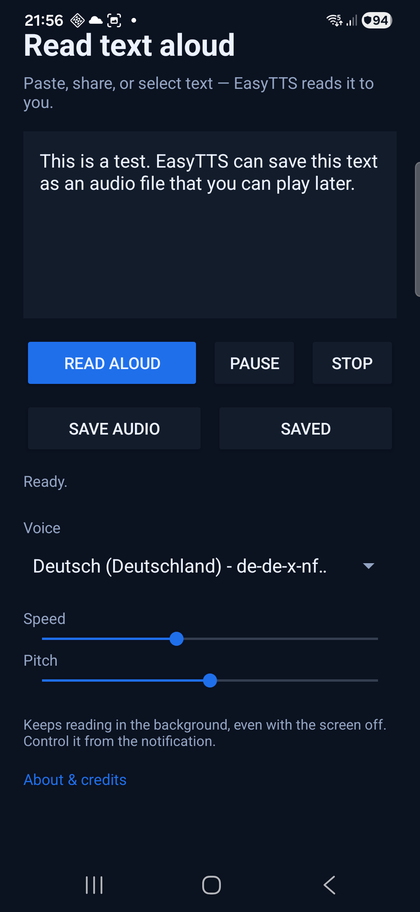

# EasyTTS

A tiny Android text-to-speech reader. Paste, share, or select text and have it
read aloud — offline, without an account, without ads.



## Features

- **Share or select text** in any app and send it to EasyTTS, or paste it
  directly.
- **Background playback** via a foreground service: keeps reading while you
  use other apps or the screen is off.
- **Notification controls**: pause, resume, and stop without opening the app.
- **Progress tracking** in 400-character parts, so pausing resumes at the same
  place instead of starting over.
- **Audio focus**: music and podcasts pause while EasyTTS reads, and playback
  stops on incoming calls.
- **Voice selection**: automatically picks the best voice for your device
  language; you can change it at any time.
- **Speed and pitch** sliders, remembered across launches.
- **Volume slider** for the media stream: changes apply immediately, even mid-sentence.
- **One-button playback**: *Read aloud* turns into *Pause*/*Resume* while
  reading; the notification offers the same controls.
- **Save audio**: export the current text to `Music/EasyTTS` as M4A (AAC),
  with a WAV fallback if encoding is unavailable.
- **Saved screen**: play, share, or delete exported files.
- **About screen** with developer credits, source link, and license.

## Requirements

- Android 8.0 (API 26) or newer.
- A text-to-speech engine (Google TTS is preinstalled on most devices).
- To build: JDK 17+ and the Android SDK.

## Build

```powershell
powershell -ExecutionPolicy Bypass -File scripts\build-apk.ps1
```

The APK is written to `dist\EasyTTS-<version>.apk` and signed with a local
debug-style key.

When run for the first time, the script generates a signing key in
`android/keystore/`. That directory is ignored by Git — keep it if you want to
ship updates with the same signature.

## Install

Copy the APK to your phone and open it, or use ADB:

```powershell
adb install -r dist\EasyTTS-0.5.1.apk
```

Wireless debugging (Android 11+):

```powershell
adb pair <ip>:<pair-port>
adb connect <ip>:<port>
adb install -r dist\EasyTTS-0.5.1.apk
```

## Usage

1. Open EasyTTS and paste text, or share text from another app.
2. Press **Read aloud**. While reading, the same button turns into
   **Pause**, then **Resume**.
3. Leave the app or lock the screen — reading continues.
4. Use the notification (or the in-app buttons) to pause, resume, or stop.
5. Press **Save audio** to export the text to `Music/EasyTTS`. The **Saved**
   screen lets you play, share, or delete the files.

The app also registers for `ACTION_PROCESS_TEXT`, so "Read aloud" appears in the
text selection menu of other apps.

## Project layout

```
android/app/src/main/java/de/voicetool/reader/
  MainActivity.java   UI, share/process-text handling, settings
  ReaderService.java  background playback, notification, audio focus
  AudioExporter.java  text-to-audio export (WAV -> AAC/M4A, MediaStore)
  SavedActivity.java  list, play, share, delete exports
  AboutActivity.java  credits, source link, license
android/app/src/main/res/   layout, strings, colors, icons
android/app/build.gradle.kts  Android Studio project (optional)
scripts/build-apk.ps1       build without Gradle
```

## How it works

- Plain Java, no AndroidX or Compose — the APK stays around 30 KB.
- `minSdk 26`, `targetSdk 36`.
- Speech is rendered by the system TTS engine, so the available voices depend
  on the device.
- The reading session runs in a foreground service with media playback type,
  which is why it survives backgrounding and screen-off.

## License

MIT — see [LICENSE](LICENSE).
